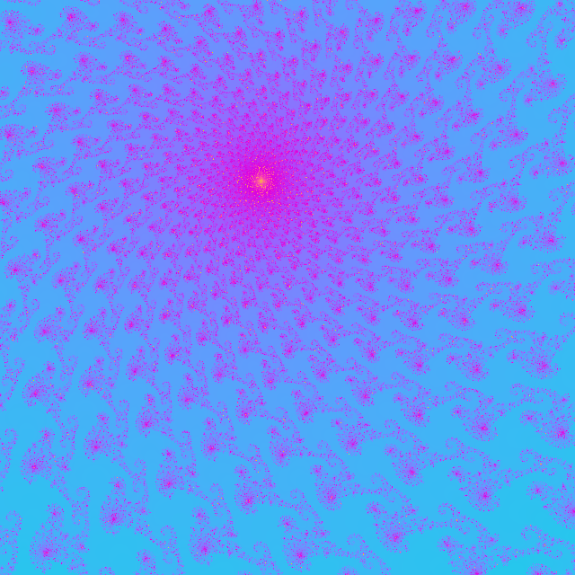

## Mandelbrot Set Solver

This solver uses Java's [BigDecimal](https://docs.oracle.com/javase/8/docs/api/java/math/BigDecimal.html) library to go much deeper into the Mandelbrot set than one could
using even the best wide but fixed width numbers.   Because such renders can take an enormous about
of time, threading and continuing after stopping are supported.  There are also many options for
the render, see [RenderConfig](https://github.com/zettix/MandelbrotSet/blob/main/src/com/zettix/fractal/RenderConfig.java) and the color opions in [ImageGen](https://github.com/zettix/MandelbrotSet/blob/main/src/com/zettix/fractal/ImageGen.java)

